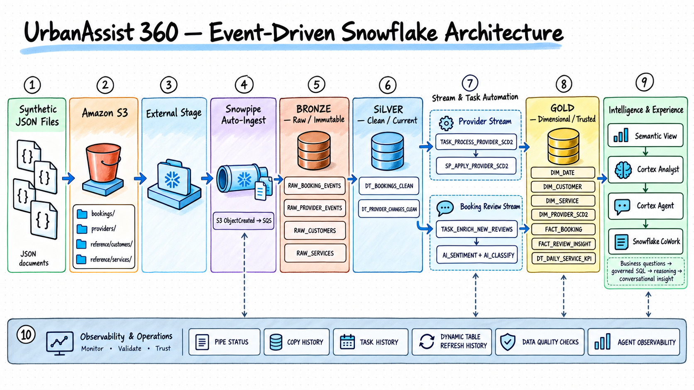
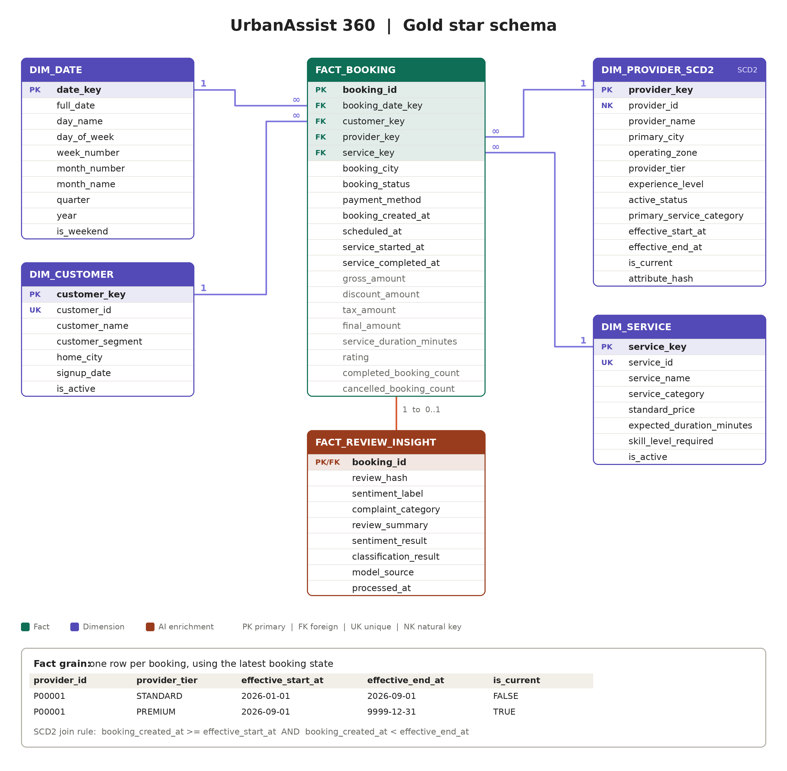
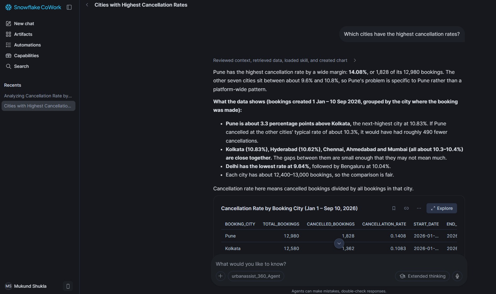
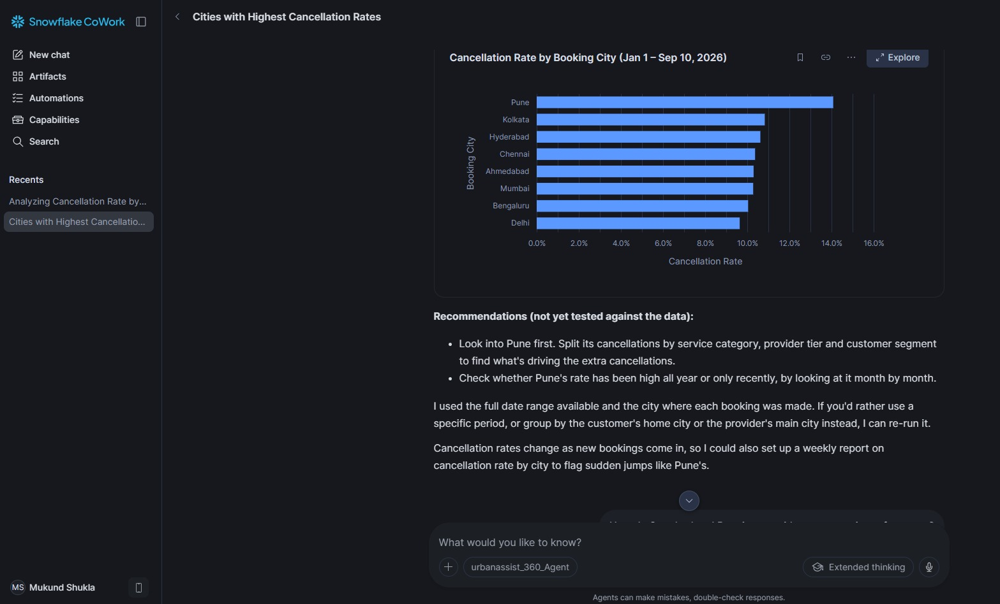
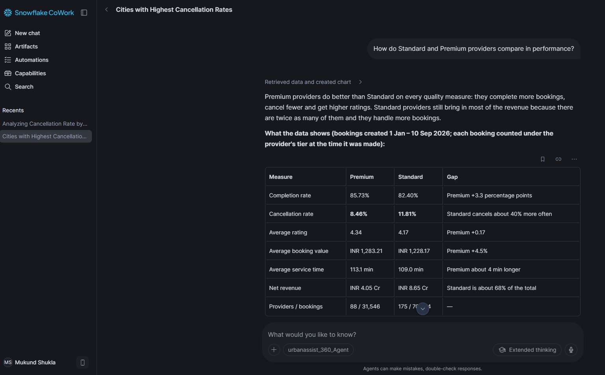
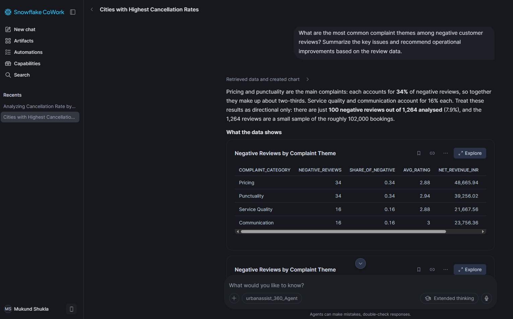
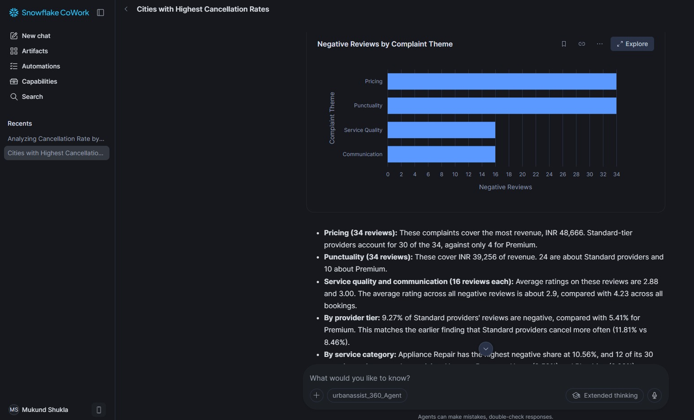

# UrbanAssist 360

**An event-driven home-services analytics platform built with Snowflake, AWS, and Snowflake Cortex.**

UrbanAssist 360 demonstrates how booking and provider events can be ingested from Amazon S3, transformed into a governed dimensional model, and used for operational analytics and AI-assisted review insights.

## What it demonstrates

- **Automated ingestion:** S3 event notifications and Snowpipe Auto-Ingest load booking and provider event files into Snowflake Bronze tables.
- **Medallion architecture:** Bronze raw events flow into cleaned Silver Dynamic Tables and then into Gold facts, dimensions, and daily KPIs.
- **Incremental change processing:** Snowflake Streams and Tasks process new events; a stored procedure maintains provider history with **SCD Type 2**.
- **AI-enriched reviews:** Snowflake AI Functions classify review sentiment and complaint themes, with results stored for analytics.
- **Governed natural-language analytics:** A Semantic View defines business terms and metrics for Cortex Analyst, which is attached to a Cortex Agent and exposed through Snowflake CoWork.
- **Operational safeguards:** Validation SQL checks duplicate bookings, key integrity, provider history intervals, and invalid measures.

## Architecture



Snowflake Dynamic Tables use a target-lag freshness objective; a five-minute target lag is **not** a five-minute cron schedule or a guarantee of exact refresh timing.

## Gold data model



**Fact grain:** one row per logical booking, representing its latest valid booking state.

| Object | Purpose |
|---|---|
| `FACT_BOOKING` | Booking status, timestamps, customer/provider/service/date keys, amounts, rating, duration, and booking flags |
| `DIM_DATE` | Calendar attributes for time-based reporting |
| `DIM_CUSTOMER` | Customer attributes and segment |
| `DIM_SERVICE` | Service name, category, price, expected duration, and required skill level |
| `DIM_PROVIDER_SCD2` | Provider attributes with effective dates and current/history indicators |
| `FACT_REVIEW_INSIGHT` | Optional AI-enriched review result linked to a booking by `booking_id` |
| `DT_DAILY_SERVICE_KPI` | Daily service performance metrics |

A provider can have multiple historical rows. Join bookings to the correct provider version through `provider_key`, not only the natural `provider_id`. A booking can have zero or one review-insight record.

## Repository layout

```text
.
├── README.md
├── scripts/
│   └── generate_data.py
├── data/
│   └── generated/       # generated, compressed JSON source files and manifest
└── sql/
    ├── setup/           # Snowflake roles, database, warehouse, S3 integration
    ├── bronze/          # stages, raw tables, pipes, reference loads
    ├── silver/          # cleaned Dynamic Tables
    ├── gold/            # dimensions, SCD2, AI enrichment, facts and KPIs
    ├── intelligence/    # Semantic View, Agent and CoWork reference SQL
    └── operations/      # validation/monitoring and live-event demonstration
```

## Example questions for the Agent

- Which cities have the highest cancellation rates?




- How do Standard and Premium providers compare in performance?



- What are the most common complaint themes among negative reviews?



The Semantic View defines governed joins and metrics such as total/completed/cancelled bookings, completion and cancellation rates, gross and net revenue, average booking value, average rating, service duration, and enriched review counts.


## Tech stack

`Snowflake SQL` · `Amazon S3` · `Snowpipe Auto-Ingest` · `Streams` · `Tasks` · `Dynamic Tables` · `SCD Type 2` · `Snowflake AI Functions` · `Cortex Analyst` · `Cortex Agents` · `Snowflake CoWork` · `Python` · `GitHub`
